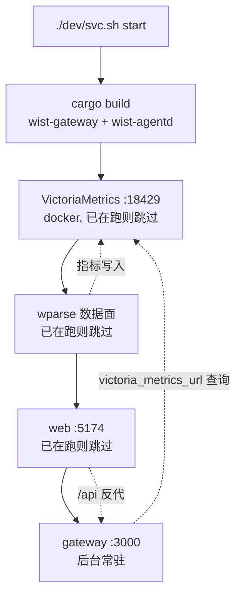

# dev —— 开发态启停（单一入口 `svc.sh`）

本目录是 wist-gateway-stack 的**开发态**运行方式：不依赖 Docker（VictoriaMetrics 除外），
直接用各仓**本地编译产物**把栈跑起来，对应发布态的 `gops run start|stop|status`（见上级 [README](../README.md)）。

**入口只有一个：`./dev/svc.sh`**。9 个分散的 start/stop 脚本已合并成它一个 —— 起/停/看全在里面，
「什么被自动执行、什么不用」只在一处定义。

> **gwlinkd 不在 `svc.sh` 里**：它是网关宿主侧的常驻，现归**系统服务** —— 装 / 更新 / 看 / 回滚走
> `./dev/install-gwlinkd-dev.sh`，断开接入走 `./dev/unlink-center.sh`。`svc.sh` **不构建、不起、不停**它。

```
wist-gateway-stack/
  sys/            # gops 系统定义（发布态）
  sys/data-plane/ # wparse 工程（只读种子：conf/connectors/models/topology + wparse.local.toml），开发态与发布态共用
  data-plane-run/ # wparse 运行态根（发布态 data/.run/work；开发态 dev/）
  dev/            # 本目录：svc.sh + 一次性工具 + 本地二进制
```

下文用 `$WIST` 表示各仓父目录，即本目录的 `../..`：

```
x-topology/wist/                  <- $WIST
  wist-gateway/                    控制面 crate
  wist-agentd/                     采集端 crate
  wist-gateway-web/                前端
  wist-gateway-stack/
    sys/data-plane/                共用 wparse 工程（只读种子）
    dev/                           <- 本目录（ROOT_DIR = $WIST，比栈根多一层）
```

## 快速开始

```bash
# 起全栈（日常）：构建一次 → 五个组件全部后台常驻（VM/wparse/web/forward/gateway）
./dev/svc.sh start

# 只看计划，不启动
./dev/svc.sh start --dry-run

# 看各组件当前状态
./dev/svc.sh status

# 重启（停 → 起）：改了配置/代码要生效时用（如 setup-domain 后重启 gateway）
./dev/svc.sh restart gateway

# 停全栈（逆序：gateway → forward → web → wparse → VM）
./dev/svc.sh stop
```

## 场景 → 跑哪个（决策树）

| 我要… | 命令 |
|---|---|
| 起全栈（日常） | `./dev/svc.sh start` |
| 停全栈 | `./dev/svc.sh stop` |
| 看状态 | `./dev/svc.sh status` |
| 重启某组件 / 全栈（改了配置/代码要生效） | `./dev/svc.sh restart [组件…]`（如 `restart gateway`、`restart web`） |
| 只停/起某个组件 | `./dev/svc.sh stop web` / `./dev/svc.sh start gateway --no-build` |
| 换域名 | `./dev/setup-domain.sh <域名>`（改配置 + 重签证书，**改完 `./dev/svc.sh restart gateway`**） |
| 不要 agent 面 / 不想碰 sudo | `./dev/svc.sh start --no-forward` |
| 把本机网关接入本机中心 | 网关页「链接上级」提交接入链接；gwlinkd 在跑（系统服务）时会自动拉取（见「接入上级」一节） |
| 断开与中心的连接（回到未接入） | `./dev/unlink-center.sh`（停 gwlinkd 服务 → 调 `wist-gwlinkd unlink` → **再起回**；可 `--dry-run`／`--no-restart`；加 `--forget-center` 连中心 CA 也清） |
| 让**系统服务**跑我刚编的 gwlinkd（发布态已装服务时） | `./dev/install-gwlinkd-dev.sh`（先 `--dry-run` 看计划；详见「把本机编译的 gwlinkd 发布到系统服务」一节） |
| 跑一次 gwlinkd 的子命令（`diagnose` / `version` / `service status`…） | `wist-gwlinkd diagnose` 单独就够（`--conf` 缺省时回落已装服务定义）；要**本地构建**或看落点用 `./dev/gwlinkd.sh --paths` |
| 把 compose 里非 wist\* 的上游镜像（VM / wparse）同步到 TCR | `./dev/push-images.sh`（先 `--dry-run` 看计划；详见「上游镜像同步到 TCR」一节） |
| 只把一个 tag 同步到 TCR（多架构、digest 校验） | `./dev/sync-to-tcr.sh <src> [<dest>]`（详见同一节） |

> **不要**再去找 `start-web.sh` / `stop-vm.sh` / `re-enroll.sh` 之类的单组件或重注册脚本 —— 前者已并入
> `svc.sh`。**本机 agentd 的重新注册不需要脚本**：网关库丢了 / 换域名时，持有效客户端证书的 agent 会
> **自动**重新登记（mTLS 自愈）；真要手动重注册，用 `wist-agentd` 自带的 `enroll`。
> `svc.sh start` 会把 `vm`/`wparse`/`web`/`forward`/`gateway` 按序起全（已在跑的跳过），你不用逐个跑。

## 组件与脚本

`svc.sh` 管**五个**组件（顺序 = 依赖序）；`forward` 在默认 `start` 里，可用 `--no-forward` 摘掉：

| 组件 | 是什么 | 前台/后台 | 说明 |
|---|---|---|---|
| `vm` | VictoriaMetrics（`18429`） | 后台（**Docker 容器**） | 第三方依赖，无本地二进制；走 `sys/docker-compose.yml` |
| `wparse` | 数据面 ELT 引擎 | 后台常驻 | 本地 `dev/bin/wparse`；种子在 `../sys/data-plane`，运行根在 `../data-plane-run/dev` |
| `web` | 前端 vite dev server（`5174`） | 后台常驻 | `npm run dev`，工作目录 `$WIST/wist-gateway-web` |
| `gateway` | 控制面后端（HTTPS `:3000`） | 后台常驻 | 跑在最后；`./dev/svc.sh stop gateway` 停 |
| `forward` | `443 → 网关端口` 纯 TCP 转发 | 后台常驻 | **在默认 `start` 里**（绑 443 要 sudo；`--no-forward` 摘掉）；见下面「组件 forward」一节 |

> **gwlinkd 不是 `svc.sh` 的组件**（已移出）：它归**系统服务**（见「把本机编译的 gwlinkd 发布到系统服务」一节）。

**五个组件都是后台常驻**：`./dev/svc.sh start` 起完就返回，不会占住终端；停用 `./dev/svc.sh stop`
（`stop gateway` 会一并停掉 443 转发 —— 网关都停了，那个 443 只会让人看到 transport error）。

## 二进制与路径（开发态实际运行的东西）

| 组件 | 二进制 / 入口 | 可覆盖 env |
|---|---|---|
| gateway | `$WIST/wist-gateway/target/debug/wist-gateway` | — |
| web | **不是二进制**：`npm run dev`（实际跑 `node_modules/.bin/vite`），工作目录 `$WIST/wist-gateway-web` | `WEB_DIR` |
| wparse | `dev/bin/wparse` | `WPARSE_BIN` |
| VictoriaMetrics | **无本地二进制**：Docker 镜像 `victoriametrics/victoria-metrics:${VM_TAG}` | `VM_TAG` 等（见 `sys/setting/vars.yml`） |
| wist-agentd | `$WIST/wist-agentd/target/debug/wist-agentd` | `WIST_AGENTD_BIN`（仅 `wist-agentd/dev/start.sh`） |

`wist-agentd` 的二进制**不再是网关配置项**（`agent.package_file` 已删）：安装包只有「管理面录入」
一个来源。dev 态要发安装命令时，到「安装包」页把本地来源填成它的宿主路径
（`$WIST/wist-agentd/target/debug/wist-agentd`）录入一次即可；录制会持久化在库里，不必每次重启再录。

### 构建策略

路径全部硬编码 **`target/debug`**，整个 `dev/` 没有一处 `target/release`。

`svc.sh start` **每次启动都会 `cargo build` 一次**两个 crate（`wist-gateway` / `wist-agentd`），
所以跑起来的一定是当前源码。cargo 增量编译在无改动时几乎瞬时；编译输出直接透传，编译错误一眼可见。
`--no-build`（或 `SKIP_BUILD=1`）跳过。

**先构建、再起组件**：只有**编译失败**才中止（没二进制后面无从谈起）。单个后台组件起不来**只 WARN、不中止整栈**
—— 组件之间互不为「启动前置」，一个慢/坏的前端不该挡住网关；会打一行**启动小结**，`status` 可复核。

> 为什么不用「缺失才编译」：`if [[ ! -x "$bin" ]]` 意味着**二进制一旦存在就永不重编**，改了 Rust
> 代码后跑起来仍是旧二进制 —— 典型症状是新接口返回 **404**，极易误判成“服务没起”。
> （wparse 不构建：它是 `dev/bin/` 里下载来的二进制，非同仓源码。）

## 启动顺序与依赖



`wparse` 与 `gateway` 都依赖 VictoriaMetrics，`web` 依赖 `gateway`。这些是**运行期**依赖，**都不是启动前置**。
`start` **不把就绪检查当硬门槛**：任一后台组件起不来只 **WARN、不中止整栈**（慢/坏的前端不该挡住网关）；
`web` 更完全不等待（pull：只有人开浏览器才用），就绪交给 `status`。`gateway` 也后台，排在最后起。

## 日志 / pidfile 速查

| 组件 | 日志 | pidfile |
|---|---|---|
| gateway | `/tmp/wist-gateway-server.log` | `/tmp/wist-gateway.pid`（**网关进程自身**的 pid） |
| web | `/tmp/wist-gateway-web.log` | `/tmp/wist-gateway-web.pid`（npm 的 pid） |
| wparse | `data-plane-run/dev/data/logs/wparse-daemon.log`、`wparse.log` | `data-plane-run/dev/data/logs/wparse.pid` |
| wist-agentd | `~/.wist-agentd/log/agentd.out` | `~/.wist-agentd/log/agentd.pid` |

gateway 的 pidfile 记的是**网关进程自身**的 pid（后台常驻，与 web/wparse 同一口径）：`svc.sh stop gateway`
直接 `kill` 它，再加端口兜底（只 kill 确认是 `wist-gateway` 的进程）。

## 状态与配置目录

| 组件 | 位置 | 内容 |
|---|---|---|
| gateway | `dev/configs/gateway/`（= `$WIST_GATEWAY_HOME`，默认） | `wist-gateway.toml`；`state/`：SQLite 库、`install-package/`；证书/私钥/信任锚/签名密钥在**共享身份**（见下） |
| wist-agentd | `~/.wist-agentd/` | `agentd.toml`、`tasks/`、`state/agent_runtime.json`（`wic_` 凭据）、`log/` |
| wparse | `data-plane-run/dev/{data,.run}/` | 运行期数据与临时产物 |

**开发态与发布态的网关持久数据是分开两个目录**：开发态在 `<栈根>/dev/configs/gateway`，发布态挂
`configs/gateway/`（两边 `victoria_metrics_url`、`public_base_url`、是否装 `[content]` 等不同，分开才各自自洽）。

**但「站点身份」是共享的、不分两态**：CA/证书/私钥/对外域名放**栈根** `identity/gateway/{public,private}/`，
开发态与发布态**共用同一份** —— 这样换域名/重签叶证书只动共享身份一次，两边看到的是同一张 CA 与信任锚。
网关配置里对证书/私钥/信任锚/签名密钥的引用是相对配置目录的 `identity/public/…`、`identity/private/…`，
靠 `dev/configs/gateway/identity` 这个 **symlink**（指向 `<栈根>/identity/gateway`）解析过去；
`svc.sh start gateway` 与 `setup-domain.sh` 都会确保该 symlink 存在。资源（库/日志/渲染配置/运行态）仍每态一份。

> ⚠️ 两边的 `admin_api_token` **不同**：登录开发态页面（`web`，默认 `:5174`）要用
> **开发态** `dev/configs/gateway/wist-gateway.toml` 里那个，**不是**发布态容器用的
> `configs/gateway/wist-gateway.toml`（两份同名、都是 `.gitignore` 的本地生成物，容易拿错）。
> 别翻文件：`./dev/svc.sh token`（只认开发态 home，顺带打印 token 出处）。
wparse 侧则是**配置共用、运行态分开**：配置在 `sys/data-plane/{conf,connectors,models,topology}`（只读种子，发布态挂进容器），
运行态开发态在 `data-plane-run/dev/{data,.run}`、发布态在 `../data-plane-run/`。
站点本地覆盖层（`[admin_api]`）在项目根 `wparse.local.toml`：发布态由种子补进工作根（容器内 `0.0.0.0:19090` + TLS），
开发态由 `svc.sh` 生成一份宿主可用的（`127.0.0.1:19091`、无 TLS；避开发布态已占用的宿主 19090），
两边都**不覆盖已存在的文件**。

网关注册表存在内嵌 SQLite 里（`state/wist-gateway-store.db`，由 `agent.store_file` 默认值 `.json`
改后缀而来），启动时自动迁移。若库中**既无 Agent 也无注册 token**，会一次性导入遗留的
`wist-gateway-store.json` 并改名为 `*.imported`；导入失败只告警，不阻断启动。

> **备份/恢复**：身份（`identity/gateway/{public,private}`）是**站点级、dev/prod 共用**的唯一一份，随栈根走；dev 自己的**运行态**是 `dev/configs/gateway/state/` 下的 **store 库** —— 库里有 agent 的**凭据**（bearer token），要让老 agent 无感回来就把它一起带上。
> `./scripts/backup-gateway.sh --from .`（身份 + 发布态渲染配置）；dev 的库（`dev/configs/gateway/state/`）按需另拷。详见根 README「备份与恢复」。

## 环境变量覆盖

| 变量 | 作用 | 默认 |
|---|---|---|
| `SKIP_BUILD` | 等价 `--no-build`（跳过 `cargo build`） | 每次都构建 |
| `SKIP_FORWARD` | 等价 `--no-forward`（整个摘掉 `forward`） | 不摘 |
| `WIST_GATEWAY_HOME` | 网关配置 + state 目录 | `<栈根>/dev/configs/gateway`（发布态另用 `configs/gateway`） |
| `GATEWAY_PIDFILE` | 网关进程 pidfile | `/tmp/wist-gateway.pid` |
| `GATEWAY_PORT` | `stop gateway` 端口兜底用的端口 | `3000` |
| `WEB_URL` | 前端地址（起停两侧必须一致） | `http://127.0.0.1:5174` |
| `WEB_DIR` | 前端目录 | `$WIST/wist-gateway-web` |
| `WEB_LOG` / `WEB_PIDFILE` | 前端日志与 pidfile | `/tmp/wist-gateway-web.log` / `.pid` |
| `WARP_INSIGHT_WEB_PROXY_TARGET` | vite 的 `/api` 反代目标 | 从网关配置推导（见下） |
| `WPARSE_BIN` | wparse 可执行文件 | `dev/bin/wparse` |
| `WPARSE_SEED` | wparse 只读种子（conf/connectors/models/topology + wparse.local.toml） | `<栈根>/sys/data-plane` |
| `WPARSE_WORK_ROOT` | wparse 开发工作根（启动时从种子 `cp -an` 补缺；`wparse.local.toml` / admin token 由 `svc.sh` 生成） | `<栈根>/data-plane-run/dev` |
| `WPARSE_VM_ENDPOINT` | wparse 写指标的 VM 端点 | `http://127.0.0.1:18429` |
| `WPARSE_GATEWAY_ENDPOINT` | wparse 的 agent-facts sink 端点 | `http://127.0.0.1:3001` |
| `GATEWAY_LISTEN` | `setup-domain.sh` 写进配置的监听地址 | `0.0.0.0:443` |
| `GATEWAY_URL_PORT` | `setup-domain.sh` 对外基址里的端口（空串 = 不带端口） | 按监听端口推导 |
| `FORWARD_LISTEN` | `forward` 组件监听的端口（**起/停/status 三侧必须一致**） | `443` |
| `FORWARD_BIND` | `forward` 绑定地址 | `0.0.0.0` |
| `FORWARD_TARGET_PORT` | `forward` 的转发目标端口 | 按网关配置推导 |
| `FORWARD_PIDFILE` / `FORWARD_LOG` | 转发器 pidfile / 日志 | `/tmp/wist-gateway-forward.pid` / `.log` |
| `FORWARD_SCRIPT` | 转发器脚本（纯 TCP，不碰 TLS） | `dev/forward-443.py` |

## 组件 `forward`：让 agent 也走 443（补发布态由 docker 提供的那一跳）

发布态 agentd 连的 `https://<域名>`（隐式 **443**）不是网关进程自己听的 —— 那是 compose 里
`${GATEWAY_PORT}:3000` 这行**端口映射**给的。dev 态没有 docker，网关按配置听高位端口（默认
`3000`），于是 agent 侧只剩“域名:3000”可填 —— 那就不是发布态那个形态了。

`forward` 就是这个缺口：一个**纯 TCP** 转发器（TLS 仍由网关终止，证书/信任锚/SNI 全部原样透传，
agent 侧地址不必带端口）。**它是默认 `start` 的一部分** —— “agent 能不能连上来”是日常问题，
不该靠人记得敲第二个命令；所以 `./dev/svc.sh start` 就会把它带上（`start [组件…]` 点名了别的组件时不带）。

```bash
./dev/svc.sh start              # 含 forward：443 → 网关监听端口
./dev/svc.sh start forward      # 只要它（网关已在跑、只补这一跳）
./dev/svc.sh stop  forward      # 只停它（root 起的会自己退回 sudo）
```

> 起没起的判据是**进程存活**（pidfile + `ps`），**不是**`lsof` 看 443 在没在听 —— 转发器是 root 起的，
> 非 root 的 `lsof` 看不见别人的监听 socket，拿它当就绪判据会永远误报。

**sudo 怎么处理**（绑 <1024 的端口要 root，但这件事不该把整次 `start` 拖死）：三级降级 ——
免密 sudo → 交互终端上要一次密码（会明确告知为什么）→ 实在要不到就**跳过并告诉你**，
栈照旧起来。只要它（`start forward`）时则是硬错误：那是你点名要的东西。

两件要知道的事：

1. **`FORWARD_LISTEN` 起停两侧必须一致**（同 `WEB_URL` 的口径）：`status`/`stop` 看的是它。
2. **网关看到的对端地址会变成 `127.0.0.1`** —— 所有 agent 挤进同一个限流桶，日志里也看不出真实
   来源（这是“纯转发”的代价）。**要保真实源 IP** 就别用它（`--no-forward`），改用内核级重定向
   （`sudo sh -c 'printf "rdr pass on lo0 inet proto tcp from any to 127.0.0.1 port 443 ->\
   127.0.0.1 port 3000\n" | pfctl -ef -'`，撤销 `sudo pfctl -F all -f /etc/pf.conf`）。

另一条路：**让网关自己就听 443**（`GATEWAY_LISTEN=0.0.0.0:443 ./dev/setup-domain.sh <域名>` +
`sudo ./dev/svc.sh start gateway --no-forward`）—— 与发布态完全一致、也不需要转发器、还保真实
源 IP，但网关会以 **root** 跑，它写的 `state/*`（库、`knowledge/`、日志）都变成 root 所有，
之后普通用户的 dev 会踩权限。

## 接入上级（控制中心）：gwlinkd 常驻（**系统服务**）

> gwlinkd 不在 `./dev/svc.sh` 里。它是**系统服务**常驻：装 / 更新 / 看走 `./dev/install-gwlinkd-dev.sh`
> （`--status` 会打出它读的是哪份 bin/config/pub），断开接入走 `./dev/unlink-center.sh`。

gwlinkd 是网关**宿主侧**的容器外常驻（设计 `gateway-secure-registration.md`，CR-003），**随网关走**：
它**轮询网关**「链接上级」页提交的接入请求，完成 `link-upstream → register`（换客户端证书），
此后走 mTLS 并周期 `status`，再消费升级计划。产品路径就是**页面**：在网关页「链接上级」粘一条接入链接。

**配置驱动**：gwlinkd 读**服务定义里那两份**（主配置 + 现场态；`./dev/install-gwlinkd-dev.sh --status`
会打出来 —— 本机现状是 `<栈根>/configs/gwlinkd/gwlinkd.toml` + `<栈根>/identity/gwlinkd/gwlinkd-pub.toml`）。要接入：

- `control_center_endpoint`：中心地址（自签中心再填 `trust_bundle` 指向它的 CA）；
- 页面路还要设 `gateway_self_endpoint`（网关环回面，如 `https://127.0.0.1:3000`）+ `gateway_self_ca`
  （环回面信任锚；网关自签 HTTPS 必需，通常是 `identity/public/gateway-ca.crt.pem`，没跑过 `setup-domain.sh`
  时可退回自签叶证书 `identity/public/admin-tls.crt.pem`）。

gwlinkd **只在未注册（首跑）时拉**页面请求（拉取发生在 `first_run`）。所以：

- home 必须是**未注册**状态（已注册就跑不到拉取那步）；换实例时清掉它的 `state/` 重走；
- `gateway_id` 须与页面接入物里的 `gateway_id` 一致；
- 接入成功的唯一副作用是往 `state/` 落客户端证书 —— 之后重启直接续用，不再需要接入券。

> 改完这两份配置要生效：`./dev/install-gwlinkd-dev.sh`（它重渲染服务定义 + 重启；`--dry-run` 先看）。
> 两份配置都是**交付物 / 现场态**：主配置由发布态渲染（`gops sys localize`），现场态在 `identity/` 下（与 dev 共用）。

**发布 ②（中心下发 agent 包）还要配两项**（dev 网关跑在**宿主**上，没有容器 —— 两项填**同一个绝对目录**即可）：
`agent_package_drop_dir = "<绝对路径，如 <栈根>/packages>"` + `agent_package_container_dir = "<同一个绝对路径>"`。
这两项指向 gwlinkd 取包后落地、再交给网关的目录；未配则 ② 计划会 fail-closed。交付成功后按
`agent_package_drop_keep`（缺省 12）保留最新若干份。

> 现象对照：页面「待 wist-gwlinkd 拉取」一直不动 → 没有 gwlinkd 在轮询这个网关（没配
> `gateway_self_endpoint`，或那个 gwlinkd 已注册、不在首跑）。

**断开连接**：`./dev/unlink-center.sh`。与 Center 的连接就是 gwlinkd 手里的**注册态**（客户端证书 / 链接
配置 / 注册券 / 身份 / 实例）加 `gwlinkd.toml` 的 `link_token`。这个清理**归 gwlinkd 自己**（`wist-gwlinkd
unlink`，与 link/`onboard` 同一个 owner），dev 脚本只负责**停服务 + 调它**，不做文件手术：

```bash
# 手工等价（`./dev/unlink-center.sh` 把这三步包了）：停服务 → 用**服务那份配置**跑 unlink → 起回服务。
# 配置路径从服务定义读：./dev/install-gwlinkd-dev.sh --status
WIST_GWLINKD_CONFIG=<主配置> WIST_GWLINKD_PUB_CONFIG=<现场态> \
  /usr/local/bin/wist-gwlinkd unlink
```

`./dev/unlink-center.sh [--dry-run] [--forget-center] [--no-restart]` 把三步包在一起：**停 gwlinkd 服务 →
unlink → 再起回**（起回后回到「等待页面接入请求」，组件不断档；要它就那样停着加 `--no-restart`）。
它自己从**服务定义**里读 bin / config / pub（与 `install-gwlinkd-dev.sh` 同一口径），所以清的是**同一份**注册态。
它**不**在 Center 侧注销（那是 center-stack 的事）：同一 `gateway_id` **无法**再接入 —— 中心没有「重置
实例」，而且这是**有意**的安全边界（不把「初始化后可再置备」的口子开出来）。要再接入就在 Center **新建
实例**、用它的**新 `gateway_id`**（gwlinkd 按新接入链接自动切过去）。**不做备份**：要留底就自己先拷
`state/`（在 dev，重接即可，备份意义有限）。

**中心信任锚（`trust_bundle` 指向的 PEM）默认保留** —— 它不是连接（是中心的公开证书），换接时页面会再给。
unlink 只删**注册态那几个文件**，**不整目录清空** —— 所以页面接入把 CA 写进 `state/`（并把 `trust_bundle`
重指进去）时也**不需要搬动**它。要连这张 CA 也一起清（真正「忘掉这个中心」）就加 `--forget-center`：
它删**已知的每一份**中心 CA（`trust_bundle` 指向的、`state/` 里的副本、配置目录下的旧副本，去重）
（之后 gwlinkd 会 WARN 回落公共根，重接时写回新 CA 即恢复）。

## 把本机编译的 gwlinkd 发布到系统服务（`install-gwlinkd-dev.sh`）

发布态把 gwlinkd 装成**系统服务**常驻（中心下发的安装脚本调：`wist-gwlinkd service install --system
--run-as <部署用户> --bin /usr/local/bin/wist-gwlinkd --config <栈根>/configs/gwlinkd/gwlinkd.toml
--pub-config <栈根>/identity/gwlinkd/gwlinkd-pub.toml`）。你在改 gwlinkd 源码，想让**这个服务跑的就是你刚编出来的那份**，用 `./dev/install-gwlinkd-dev.sh`：

```bash
./dev/install-gwlinkd-dev.sh --dry-run   # 只看计划（连会写进去的服务定义都渲染出来）
./dev/install-gwlinkd-dev.sh             # 构建 debug → 备份旧二进制 → 换上 → 重写定义并重启 → 验证
./dev/install-gwlinkd-dev.sh --release   # 用 target/release 的产物（默认 debug，与 dev 其余脚本同口径）
./dev/install-gwlinkd-dev.sh --status    # 只看服务现状（不构建、不改任何东西）
./dev/install-gwlinkd-dev.sh --rollback  # 换回最近一次备份并重启
```

- **编译归本脚本**：默认 `cargo build`（debug，编 `<crate>/target/debug/wist-gwlinkd`）→ 拷过去；
  `--release` 编 release、`--no-build` / `SKIP_BUILD=1` 用现有产物。这也是 `svc.sh` 不再编 gwlinkd 之后的唯一构建入口。

- **只动二进制 + 服务定义**：不写配置、不碰注册态/凭据（enrollment 与 `state/` 原样）—— 它就是「换代码」这一件事。
- **沿用服务现有的发布态配置**：`--config` / `--pub-config` 直接从已装的 plist/unit 里读出来（读不到才退回本栈的
  `<栈根>/configs/gwlinkd/gwlinkd.toml`、`<栈根>/identity/gwlinkd/gwlinkd-pub.toml`）；要换用别的加
  `WIST_GWLINKD_DEV_CONFIG` / `WIST_GWLINKD_DEV_PUB_CONFIG`。
- **拷到服务的位置**：默认入口 `/usr/local/bin/wist-gwlinkd`（`WIST_GWLINKD_DEV_BIN` 可改）。中心装的那份
  入口是**符号链接**，真身在 `/usr/local/lib/wist-gwlinkd/wist-gwlinkd`（目录与文件都归运行用户）；
  本脚本会顺链接换**真身**，不会把链接改成普通文件。覆盖前先 `cp -p` 备份成 `*.bak-<时间戳>`，
  换完用 sha256 校验（不一致即报错），`--rollback` 换回最近一次。
- **换完还体检自更新布局**：gwlinkd 的自更新要在进程内“同目录写临时文件 + rename”覆盖真身，**目录**必须对
  运行用户可写。落在 `/usr/local/bin`（root 拥有）时会 `[warn] 自更新会失败`，并提示重跑中心「只装 gwlinkd」——
  别把链接换成 root 的普通文件，那正是这条警告的成因。
- **运行身份仍是部署用户**（`--run-as $(id -un)`）：别让服务以 root 跑 —— gwlinkd 会回写配置、落身份、驱动
  `gops` 升级，那些都该是部署用户的属主（与中心安装脚本同一口径）。
- **gwlinkd 只归这一个服务**：`svc.sh` 已不管它（不构建、不起、不停）。本脚本装服务前只兜底清掉
  「老的 nohup 形态」残留进程 —— 它不归服务管理器管，却占着同一个 state 目录的 `flock`，留着服务起不来。
- **要停 / 卸载**：`sudo /usr/local/bin/wist-gwlinkd service uninstall --system`（停用并删定义）。
  只想临时停一下：macOS `sudo launchctl bootout system/com.dayu-sec.wist-gwlinkd`、
  Linux `sudo systemctl stop wist-gwlinkd`。
- **不想敲那三串长路径**：`wist-gwlinkd` 自己就能兜（`--conf` 缺省时，`diagnose` / `service status` 回落读**已装服务定义**里那份，见它自己的 README）；dev 侧的 `./dev/gwlinkd.sh <子命令>` 是另一条——它把 bin/config/pub 从定义里读出来、默认用**服务已装的那个二进制**，还能 `--bin` 指定本地构建、`--paths` 只看落点。它只是穿透，不管进程生命周期（要 root 的子命令自己加 `sudo`）。

> 日志：macOS `sudo tail -f /var/log/wist-gwlinkd/gwlinkd.err`；Linux `journalctl -u wist-gwlinkd -f`。

## 上游镜像同步到 TCR（`push-images.sh` / `sync-to-tcr.sh`）

两个脚本分工不同，别混用：

| 脚本 | 适合 | 多架构 |
|---|---|---|
| `push-images.sh` | 按 compose 清单批量同步（VM + wparse） | buildx 路径保留 index；`--method pull` **只推当前宿主架构** |
| `sync-to-tcr.sh` | 单个镜像精确同步 / 手动补一个 tag | 用 skopeo 做 manifest 级复制，**恒定保留多架构**，digest 与源一致并回读校验 |

> 只想补一个 tag（如 `warp-parse:0.34.0-alpha`）时用 `sync-to-tcr.sh`；
> 在 Apple Silicon 上跑 `push-images.sh --method pull` 会推出 arm64-only 镜像，
> amd64 现场拉到后 `docker run` 直接 `exec format error`。

```bash
./dev/sync-to-tcr.sh ghcr.io/wp-labs/warp-parse:0.34.0-alpha           # 单个镜像
./dev/sync-to-tcr.sh <src> <dest>                                      # 指定目标
./dev/sync-to-tcr.sh -n <src>                                          # 只检查，不推送
./dev/sync-to-tcr.sh -f images.txt                                     # 每行 "<src> [<dest>]"
```

`sys/docker-compose.yml` 里的镜像分两类：**wist\*** 由发布流水线双推（`ghcr.io/dayu-sec/*` 与
`dy-sec.tencentcloudcr.com/cloud/*`），TCR 里本来就有；**victoria-metrics / wparse 是上游镜像**
（`victoriametrics/victoria-metrics`、`ghcr.io/wp-labs/warp-parse`），TCR 里**没有**。内网 / 客户环境
只方便拉 TCR 时，用 `./dev/push-images.sh` 把非 wist\* 的那几个也推进同一个 `cloud` 命名空间：

```bash
./dev/push-images.sh --dry-run     # 只列「会推哪些、推到哪」
./dev/push-images.sh               # 推（先 `docker login dy-sec.tencentcloudcr.com`）
./dev/push-images.sh --force       # 云上已有也覆盖推（默认已有就跳过）
```

- **登录预检（先查再推）**：推之前先查本机是否已为 `TARGET_HOST` 存了登录凭据（与 docker 自身同一套
  解析：`credHelpers[host]` → `credsStore` → 内联 `auths`）。**没登录就直接报错退出**（不撞 401）；
  `--dry-run` 只告警继续。查不了（无 python3）或想绕过预检：`SKIP_AUTH_CHECK=1`。
  ⚠ 预检只判「有没有凭据」，判不了「凭据是否有 push 权限 / 是否过期」——那只有真推才知道。
- **失败分类提示**：推送失败会按报错给出方向 —— `429 Too Many Requests` → **源仓库限流**（`docker.io`
  匿名拉取有额度：`docker login docker.io` 提高额度，或稍后重试）；`401/403 unauthorized` → **目标鉴权**
  （`docker login <目标 host>`）。
- **云上已存在先探后推**：默认先**只读探一下**目标仓库（`buildx imagetools inspect`，不 pull、不下载）——
  命中且与源 **digest 一致**就**跳过**（幂等，重复跑不白推）；命中但 digest 不同（上游 tag 被重指等）
  默认**只告警不覆盖**；确实要覆盖加 `--force`。探不到（未登录 / 网络问题）不假装「不存在」，仍会尝试推送。
- **推完自动自检**：每推完一个就**再 inspect 一遍**目标地址、比对 digest 是否落地，不符则整趟以非零码退出
  （不只看 `push` 命令的退出码就算成功）。buildx 路径比**源 index digest**（imagetools 逐字节保留）；
  `--method pull` 路径比 **`docker push` 输出里的平台 digest**（只推当前架构，digest 本就与源 index 不同）。

- **取镜像的唯一源是 `docker compose config --images`** —— 让 Compose 自己解析 compose 里的 `${VAR}`
  （值来自 `sys/merged_vars.yml` 产品默认 + 栈根 `.env` 现场覆盖），脚本不另造一套解析规则。
- 目标仓库名默认取源镜像**末段**（`victoriametrics/victoria-metrics` → `cloud/victoria-metrics`），
  与 `cloud/wist-gateway` 的扁平命名一致；要保留源路径加 `--keep-path`；换目标用 `--registry`。
- 默认走 `docker buildx imagetools create`：**不落本地、保留多架构 manifest**（`docker pull/tag/push`
  只推当前宿主那一种架构）；无 buildx 时自动回落 `--method pull`。
  ⚠ 所以 `--method pull` **必须在现场同架构的机器上跑**：在 Apple Silicon 上推出来的 `warp-parse`
  只有 arm64，amd64 现场拉到后 `docker run` 直接 `exec format error`（localize 阶段会在
  `scripts/init-wparse-admin.sh` 上失败并触发整工程回滚）。
- 推完按脚本末尾提示把 compose 指过来：compose 的三个源前缀 `WIST_SPC` / `WARP_SPC` / `VM_SPC`
  （默认见 `sys/setting/vars.yml`）在 `values/value.yml` 覆盖成 `${TARGET_REGISTRY}` 后 `gops sys localize`
  （tag 不变）。例：VM 撞 Docker Hub 限流时，把 `VM_SPC` 指到 `quay.io/victoriametrics` 即可换源。

## 注意事项

1. **gateway 是 HTTPS**。排查时用 `https://` + `curl -k`；用 `http://` 会得到 TLS 握手失败
   （`Received HTTP/0.9`，网关日志是 `failed TLS handshake … InvalidContentType`）。
2. **前端反代目标由 `svc.sh` 从网关配置推导**（取 `[server] listen_addr` 的端口 →
   `https://127.0.0.1:<port>`；读不到配置才回落 `https://localhost:3000`，可用
   `WARP_INSIGHT_WEB_PROXY_TARGET` 覆盖）。target 必须写成 `https://`（`server.proxy` 已设
   `secure: false`，不校验自签证书）；写 `http://` 会撞上第 1 条的 TLS 握手失败，表现为反代全挂。
3. **`stop web` 的端口兜底会误伤**：它除了按 pidfile 停，还会清理该端口上所有监听进程。若你另外手工
   `npm run dev` 起过前端，注意它可能是 Vite 默认的 **5173**（本目录固定 **5174** `--strictPort`），
   两者不是同一个实例，别互相误停。
4. **`dev/bin/` 不入 git**（约 92M），随发布包也不带。里面只有 `wparse` 被脚本使用；`wpadm` / `wpgen`
   / `wpl-check` / `wprescue` 是**手工 WPL 开发工具**，无脚本引用（见 `../sys/data-plane/models/wpl/mac/README.md`）。
5. **`../sys/data-plane/` 是 wparse 配置的唯一源（只读种子）**，开发态与发布态共用，且由发布态 compose 按目录只读挂载
   （`${WPARSE_WORK_DIR}/conf → /data/conf` 等）。改它等于同时改两条运行路径；改动后若影响变量，
   要重跑 `gops sys update && gops sys localize`。**运行态不共享**：开发态写 `data-plane-run/dev/{data,.run}`，
   发布态写 `../data-plane-run/{data,.run}`（`WPARSE_RUN_DATA` / `WPARSE_RUN_STATE`）；开发启动时会从种子 `cp -an` 补缺。
6. **同一 work root 只能跑一个 wparse 引擎**（引擎自身没有单实例保护，实测两个实例会互写
   `.run/authority.sqlite` 与输出）。两道保障：`svc.sh` 先拿**与容器同一位置**的锁
   `<work-root>/.run/.wparse.lock`（macOS 没 `flock(1)`，用 python3 的 `fcntl`，锁 fd 设成可继承才能跨
   `exec` 存活）——拿不到立刻退出（75）；另用 `docker ps --filter volume=<work-root>` 探测有没有容器挂着。
   已知边界：macOS 上容器与宿主**不共享** flock（work root 是 virtiofs），**反方向拦不住**（dev 先起、
   容器后起会两边都跑）；默认靠运行态目录隔离就不会撞。
7. **停 wparse 只在 `ps` 确认 pid 确实是 wparse 时才 kill**：pidfile 可能被别的进程写过（典型：容器把
   `pid=1` 写进共享 work root 时，盲 `kill` 会去杀 launchd/systemd）——已加护栏，发现不对会拒绝并提示。
8. **`setup-domain.sh` 要求 gateway 已起过**（需配置存在）；它是**按需一次性工具**，不属于 `svc.sh start` 流程。
   本机 agentd 的重新注册**不需要专门脚本**：持有效客户端证书的 agent 会在网关库丢失/换域名时**自动**重新登记（mTLS 自愈）；真要手动重注册，用 `wist-agentd` 自带的 `enroll`。
9. **信任锚走文件，且通常是 CA 根**：配置里是 `[agent] trust_bundle_file`（相对配置目录）。`svc.sh`
   每次启动把它指向共享身份里的 `identity/public/gateway-ca.crt.pem`（跑过 `setup-domain.sh` 就有这张小 CA），没有 CA 时才退回叶证书
   自身 `identity/public/admin-tls.crt.pem`。旧的 `trust_bundle = """…"""` 内联写法已迁移（新配置不认它，留着会以
   `missing field trust_bundle_file` 起不来）。叶证书是 `CA:FALSE` 形态（`CA:TRUE` 会被 rustls 以
   `CaUsedAsEndEntity` 拒收）。**只要锚（CA）不变，轮换叶证书 / 换域名是安全的**，agent 无感；
   只有**锚变了**（换 CA、删掉 `gateway-ca.*` 重生成）才需要**重跑安装**刷新 agentd 内嵌的 `trust_bundle`
   （仅重新注册/enroll 不刷新它）。
10. **`setup-domain.sh` 只改配置/证书，不重启 gateway**：改完记得 `./dev/svc.sh stop gateway && ./dev/svc.sh start gateway`。
11. **开发态不需要宿主属主对齐**：这里跑的是本地二进制、以你自己的身份读写，没有「容器固定 999:999 +
    bind 挂载不改属主」那套问题。发布态由 `gops sys perms --apply`（gops ≥ 2.7）在 `gops sys localize`
    里自动跑，macOS/OrbStack 上直接跳过。

## 目录

```
dev/
  README.md                     # 本文件
  svc.sh                        # 唯一入口：start / stop / restart / status（管 vm/wparse/web/forward/gateway）
  setup-domain.sh               # 按需：把网关切到某域名（在共享身份 identity/gateway 建/复用 CA + 签叶证书 + 改配置）
  unlink-center.sh              # 按需：断开与 Center 的连接（停 gwlinkd 服务 → unlink → 起回；见「接入上级」小节）
  install-gwlinkd-dev.sh        # 按需：把**本机编译的** gwlinkd 发布到系统服务（换二进制 + 重写定义 + 重启）
  gwlinkd.sh                    # 按需：在**服务那份配置**上跑 gwlinkd 子命令（省掉三串长路径；--paths 看落点）
  push-images.sh                # 按需：把 compose 里非 wist* 的上游镜像（VM / wparse）同步到腾讯云 TCR
  forward-443.py                # `forward` 组件的纯 TCP 转发器（443 → 网关监听端口）
  tests/                        # 回归测试（开发态工具；knowledge 纯本地）
    install-initial-knowledge.test.sh #  localize 的初始知识库步骤：空 URL 告警 / 缺包失败 / 包在就位
  bin/                          # wparse 等本地二进制（不入 git）

../sys/data-plane/              # wparse 工程（开发态与发布态共用的只读种子，属 sys/）
  conf/ connectors/ topology/ models/
../data-plane-run/              # wparse 运行态根（发布态 data/.run/work；开发态 dev/）
../identity/gateway/{public,private}/  # 站点身份（CA/证书/私钥）—— dev 与发布态共用；dev home 的 identity 是它的 symlink
```
